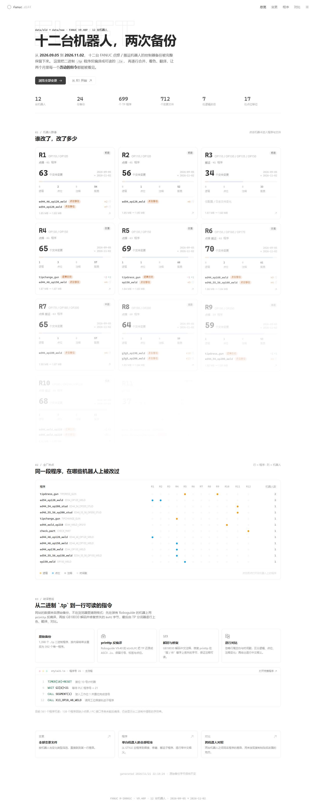
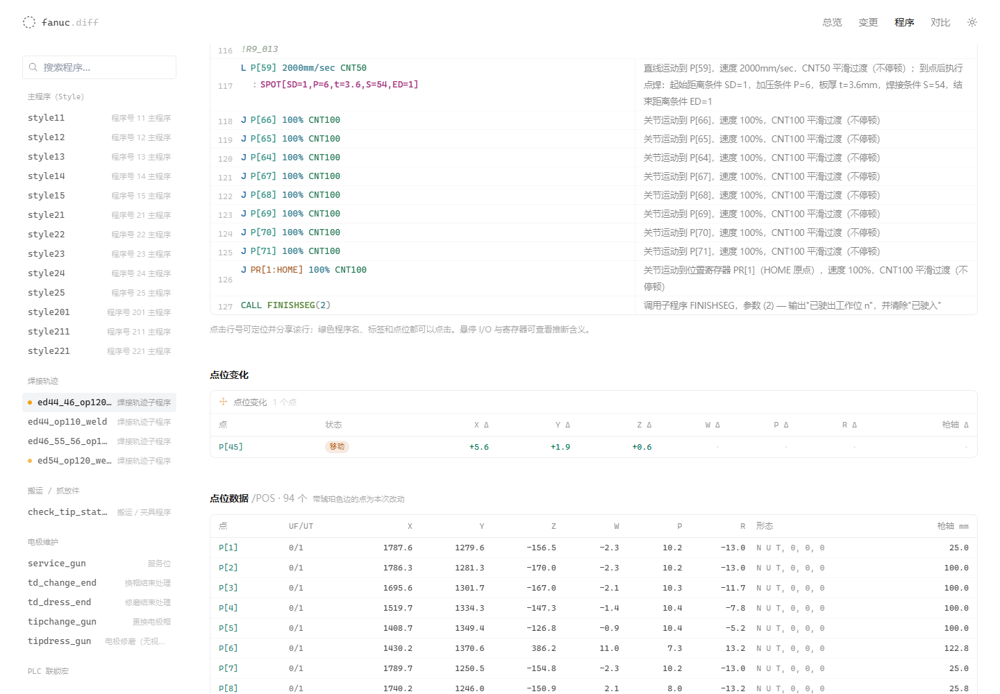
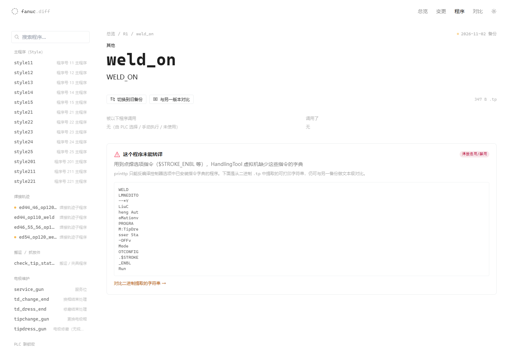

# fanuc-diff

12 台 FANUC 点焊 / 搬运机器人的两次控制器备份（`data/old`、`data/new`）的差异阅读器，同时把二进制 `.tp` 程序转译成可读的 `.ls`，逐行着色、中文释义、点位对照。

视觉与工程结构参考了 `fanuc-codeview`（TP 反编译、Vitesse 配色、antfu.me 风格）和 `codeview`（多备份 / 逐行 diff）。



## 功能

- **总览**：12 台机器人的变更规模、程序 / 配置分类、全厂热点程序矩阵。
- **变更**：712 个变更文件，按机器人 / 类型 / 状态筛选；默认先看 27 个程序变更。
- **程序**：按主程序、焊接轨迹、搬运、电极维护、PLC 联锁等分组；逐行 TP 词法高亮、中文释义、调用关系、点位表。
- **对比**：同一台机器人 `old → new` 的逐行差异；程序文件按 TP 词法着色，支持忽略空白 / 时间戳、上下文行数、分栏 / 合并。
- **跨机器人**：两台机器人同名程序的差异，适合检查复制粘贴后改漏的地方。
- **点位变化**：焊点坐标的 `ΔX/ΔY/ΔZ/ΔW/ΔP/ΔR` 与焊枪轴变化单独列表；程序页也可高亮改动的代码行。
- **未转译兜底**：printtp 缺少对应软件选项时会失败，页面仍显示从二进制中提取的可打印字符串，并可与另一备份做字符串级 diff。

| 逐行对比 | 程序转译 |
| --- | --- |
|  |  |

| 点位变化 | 未转译程序 |
| --- | --- |
|  |  |

## 快速开始

```bash
pnpm install
pnpm dev          # 生成数据 + 启动 Vite
pnpm build        # 生成数据 + 类型检查 + 静态构建到 dist/
pnpm preview
```

`dist/` 使用相对路径，可以直接拷贝到任意静态服务器。

## 数据流程

```
data/old/r1..r12       2026-09-05 备份
data/new/r1..r12       2026-11-02 / 11-03 备份
        │
        ├─ scripts/convert-tp.ps1   printtp.exe → data/ls-cache/<sha256>.ls
        │                          按 .tp 内容哈希去重，同一程序只转一次
        │
        └─ scripts/build-data.mjs
              ├─ GB18030 解码 + 修复 printtp 丢失的 0xFE 字节
              ├─ 程序语义比较：逻辑 / 点位 / 注释 / 时间戳
              ├─ 生成 public/data/index.json / changes.json / robot/*.json
              └─ 生成内容寻址的 public/data/blob/<sha1>.txt
```

`pnpm dev` / `pnpm build` 会自动调用 `build-data.mjs`，已有缓存时不会重复调用 printtp。

### 重新反编译 TP

需要装有 Roboguide / WinOLPC 的 Windows：

```powershell
# 默认使用 HandlingPRO4\Robot_1 + V9.40-1
pwsh -NoProfile -File scripts/convert-tp.ps1
```

脚本会遍历 `data/old`、`data/new` 下所有 `.tp`，按 SHA-256 去重后调用：

```
C:\Program Files (x86)\FANUC\WinOLPC\bin\printtp.exe
```

转换结果按哈希缓存在 `data/ls-cache/`。当前 1,398 个 `.tp` 去重后为 392 个唯一程序，321 个成功转译；65 个失败主要是 `-bcked*` 编辑临时备份、PC Interface 宏和 `weld_on` / `spot_count_bg` 等点焊选项指令。程序级统计为 699 个当前程序中有 561 个可读、138 个未转译。

失败原因通常是虚拟机器人缺少原控制器的软件选项字典，可以在 Roboguide 中新建一台带对应选项（SpotTool+、PC Interface 等）的机器人，再用 `-Robot` 参数指向它重跑。

## 目录

```
data/old, data/new      原始备份
data/ls-cache           按内容哈希缓存的 .ls + 转换报告
scripts/convert-tp.ps1  TP → LS（Roboguide printtp）
scripts/build-data.mjs  生成站点数据
public/data/            构建产物：manifest、机器人 JSON、懒加载 blob
src/lib/tp.ts           TP 解析器 / 分词器
src/lib/diff.ts         行级 diff、忽略空白 / 时间戳、改动行号
src/lib/render.ts       逐行渲染模型
src/data/notes.ts       程序类别与说明
src/data/signals.ts     I/O、寄存器含义
src/views/              总览 / 变更 / 机器人 / 程序 / 对比 / 跨机器人
```

## 说明

- 原始备份字节保持不变；所有差异来自内容哈希或解码后的文本比较。
- 程序级“逻辑改动”会剥离 `/ATTR` 时间戳、注释和 `/POS` 点位后再比较；点位、注释、时间戳分别标记。
- 二进制配置文件（`.vr`、`.sv`、`.dg`、`.dt`、`.io`、`.cm` 等）的 diff 是基于可打印字符串的辅助视图，不能代替控制器逐字段确认。
- 点位数据来自 `/POS` 中的 GP1（机器人 TCP）与 GP2（伺服焊枪轴），仅供参考；安全相关判断以控制器原始备份为准。
