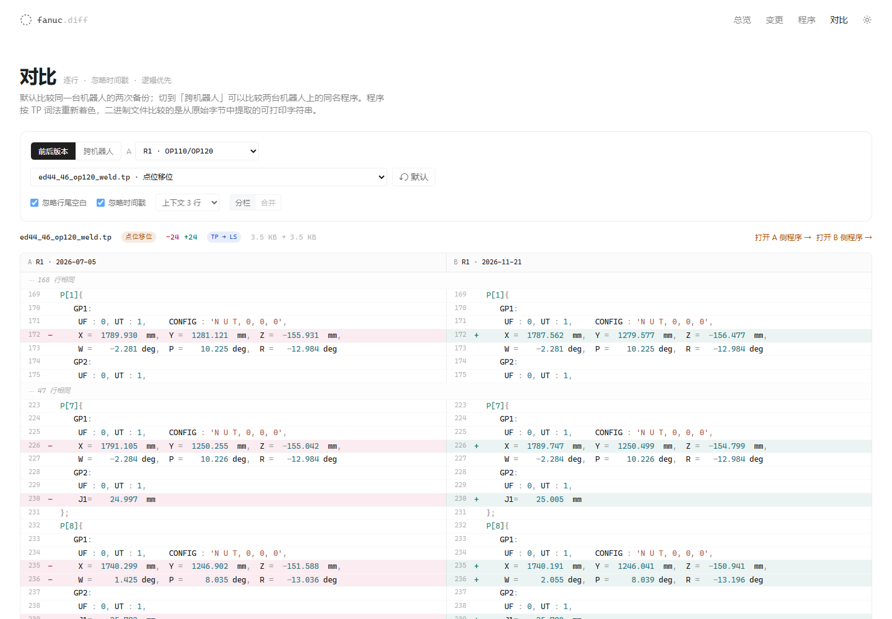
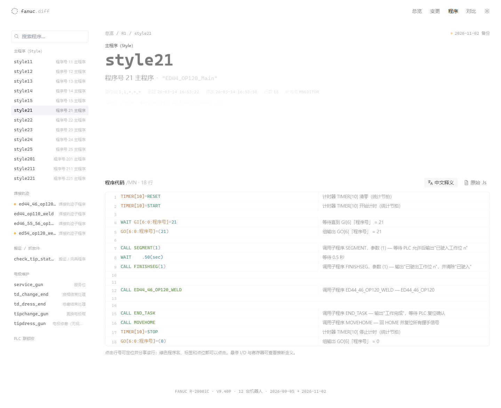

# fanuc-diff

10 台 FANUC 点焊 / 搬运机器人的两次控制器备份对比：

- **2026-07-05**：`data/7`，12 台机器人
- **2026-11-21**：`data/11.21`，10 台机器人

r3、r11 没有 11.21 备份，因此不参与本次对比。页面把二进制 `.tp` 转译成可读 `.ls`，逐行着色、中文释义、点位对照和差异对比。

视觉与工程结构参考了 `fanuc-codeview`（TP 反编译、Vitesse 配色、antfu.me 风格）和 `codeview`（逐行 diff）。


## 功能

- **总览**：10 台机器人、20 份备份的变更规模、配置 / 程序分类、全厂热点程序矩阵。
- **变更**：667 个变更文件，按机器人、类型、状态筛选；默认全部类型，可勾选「只看焊接程序」聚焦 STYLE 主程序与 `*_WELD` 焊接轨迹。
- **程序**：按主程序、焊接轨迹、搬运、电极维护、PLC 联锁等分组；逐行 TP 词法高亮、中文释义、调用关系、点位表。
- **对比**：7 月与 11 月 21 日的逐行差异；支持忽略空白 / 时间戳、上下文行数、分栏 / 合并。
- **跨机器人**：两台机器人同名程序的差异，适合检查复制粘贴后改漏的地方。
- **点位变化**：焊点坐标的 `ΔX/ΔY/ΔZ/ΔW/ΔP/ΔR` 与焊枪轴变化单独列表；程序页也可高亮改动的代码行。
- **未转译兜底**：printtp 缺少对应软件选项时会失败，页面仍显示从二进制中提取的可打印字符串，并可与另一备份做字符串级 diff。

| 逐行对比 | 程序转译 |
| --- | --- |
|  |  |

| 点位变化 | 未转译程序 |
| --- | --- |
|  |  |

## 快速开始

```bash
pnpm install
pnpm dev          # 生成数据 + 启动 Vite
pnpm build        # 生成数据 + 类型检查 + 静态构建到 dist/
pnpm preview
```

`dist/` 使用相对路径，可以直接拷贝到任意静态服务器。

## 数据统计

| 项目 | 数值 |
| --- | ---: |
| 机器人 | 10（r1、r2、r4–r10、r12） |
| 快照 | 2（2026-07-05 / 2026-11-21） |
| 机器人备份 | 20 |
| 最新程序 | 628 |
| 变更文件 | 667 |
| 程序变更 | 36 |
| 逻辑改动 | 12 |
| 点位移位 | 20 |
| 最新程序可读 | 508 / 628 |
| `.tp` 文件总数 | 1,327 |
| 唯一 `.tp` 内容 | 401 |

## 数据流程

```
data/7/r1..r12       2026-07-05 备份
data/11.21/r1..r10   2026-11-21 备份（r3/r11 无）
data/ls-cache/       printtp 转出的 .ls，按 .tp 内容哈希缓存
        │
        ├─ scripts/convert-tp.ps1   printtp.exe → data/ls-cache/<sha256>.ls
        └─ scripts/build-data.mjs
              ├─ GB18030 解码 + 修复 printtp 丢失的 0xFE 字节
              ├─ 逻辑 / 点位 / 注释 / 时间戳分类比较
              └─ 生成 public/data/index.json / changes.json / robot/*.json / blob
```

`pnpm dev` / `pnpm build` 会自动调用 `build-data.mjs`，已有缓存时不会重复调用 printtp。

### 重新反编译 TP

需要装有 Roboguide / WinOLPC 的 Windows：

```powershell
pwsh -NoProfile -File scripts/convert-tp.ps1
```

脚本遍历 `data/7` 与 `data/11.21` 的 `.tp`，按 SHA-256 去重后调用：

```
C:\Program Files (x86)\FANUC\WinOLPC\bin\printtp.exe
```

唯一 `.tp` 内容 401 个，其中 335 个已有缓存 `.ls`；66 个失败主要是 `-bcked*` 编辑临时备份、PC Interface 宏和 `weld_on` / `spot_count_bg` 等缺少选项字典的程序。

## 目录

```
data/7, data/11.21        原始备份
data/ls-cache             按内容哈希缓存的 .ls
scripts/convert-tp.ps1    TP → LS（Roboguide printtp）
scripts/build-data.mjs    生成站点数据
public/data/              构建产物：manifest、机器人 JSON、懒加载 blob
src/lib/tp.ts             TP 解析器 / 分词器
src/lib/diff.ts           行级 diff、忽略空白 / 时间戳、改动行号
src/lib/render.ts         逐行渲染模型
src/data/notes.ts         程序类别与说明
src/data/signals.ts       I/O、寄存器含义
src/views/                总览 / 变更 / 机器人 / 程序 / 对比 / 跨机器人
```

## 焊点重复分析

最新备份（2026-11-21）中：

- 507 个含 `SPOT` 的程序、1,302 条焊点指令。
- **单个程序内部：0 组重复坐标**；同一个 P 也没有被多条 SPOT 重复使用。
- **不同机器人之间：0 组重复坐标**。
- 同一台机器人、不同焊接程序之间：310 组重复坐标、893 条焊点指令，主要是不同 `ED*_WELD` 方案共用点位表。

完整报告：[docs/weld-duplicate-analysis.md](docs/weld-duplicate-analysis.md)；全部重复明细：[docs/weld-duplicates.csv](docs/weld-duplicates.csv)。

## 说明

- 原始备份字节保持不变；差异来自内容哈希或解码后的文本比较。
- 程序级“逻辑改动”会剥离 `/ATTR` 时间戳、注释和 `/POS` 点位后再比较；点位、注释、时间戳分别标记。
- 二进制配置文件（`.vr`、`.sv`、`.dg`、`.dt`、`.io`、`.cm` 等）的 diff 是基于可打印字符串的辅助视图，不能代替控制器逐字段确认。
- 点位数据来自 `/POS` 中的 GP1（机器人 TCP）与 GP2（伺服焊枪轴），仅供参考；安全相关判断以控制器原始备份为准。
